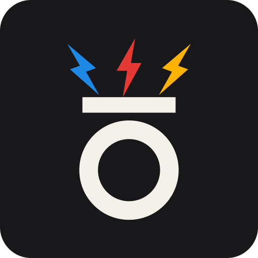

<p align="center"></p>

# meshchōsei – MeshCore & ZephCore LoRa Repeater Configurator for Android

<p align="center">
  <a href="https://github.com/meshchosei/meshchosei/releases/latest"><b>⬇ Download the latest APK</b></a> ·
  <a href="https://meshchosei.github.io/meshchosei/">Project page</a> ·
  <a href="#deutsch">Deutsch</a>
</p>

**meshchōsei** (調整, Japanese for “tuning, fine adjustment”) is a free, open-source native Android app (Kotlin, Jetpack Compose) for configuring and maintaining **MeshCore** and **ZephCore** LoRa mesh repeaters – directly via **USB-OTG** serial, or remotely over **LoRa** through a **companion node** (BLE/USB) using remote admin. Built for off-grid mesh networks, ham radio and community LoRa operators. UI in English, German, Dutch and French, switchable without restart.

## Features

- **USB serial (OTG) and Bluetooth LE** connection: CH340, CP210x, FTDI, nRF52 CDC, ESP32, RP2040 and more; remote admin login to any repeater in the mesh via a companion node.
- **Auto-detection** of role (repeater/companion), firmware and feature set.
- **Startup scan:** strictly sequential read of hardware, radio, identity, routing, filters and regions, with every reply validated and matched to its command (tagged replies over LoRa).
- **Mesh-care mode:** temporarily lowers TX power during maintenance (`tempradio`); the firmware restores it on its own, even if the app disconnects.
- **Radio & region:** LoRa frequency, bandwidth, spreading factor, coding rate, TX power and duty cycle with country presets and compliance limits (EU ETSI EN 300 220).
- **Hardware & antenna:** board detection, antenna and cable-loss presets, ERP/EIRP calculator, power source (battery/USB/solar), status LEDs.
- **Identity & location:** node name, owner info, coordinates on an OpenStreetMap map, admin/guest passwords, keys.
- **Routing & adverts:** forwarding, path hash mode, loop detection, advert intervals, multi-ACKs and full **region management** (`region home/default/put/remove/allowf/denyf`).
- **Packet filters:** blacklist (Dutch MeshCore filter) and whitelist for channels, path prefixes, senders, text, hops and packet age, with dry-run.
- **CLI console** with a complete, translated command reference and automatic retry over LoRa.
- **Backup & restore** of all settings, regions and filter lists as JSON; restore only sends what differs.
- **Firmware / OTA update** for nRF52 boards via the integrated official **Nordic BLE DFU** library: pick a DFU `.zip`, send `start ota` to the connected repeater or scan for a device in DFU mode, confirm by slider and follow the four phases with percentage and transfer rate.
- **Confirmed saves:** a change counts as saved only once the repeater acknowledges it.
- **Bauhaus UI** with light and dark mode.

## Supported Firmwares & Hardware Profiles

| Firmware | Support |
|---|---|
| **MeshCore** (repeater, companion) | full: CLI variables, regions, remote admin via companion |
| **ZephCore** (repeater, companion) | full, plus packet filters (blacklist/whitelist) and LED control |
| **Dutch MeshCore** (filter) | blacklist filter commands (DMC) |
| **jhuebert/MeshCore** (community fork) | CLI reference & autocomplete: rule-based packet filter, battery guard, power/RX duty cycle, Radio2, ham mode, MeshClock, fleet scripts, bot, LoRa/online OTA, MQTT observer |
| **Sweden-Mesh LOU** (community fork) | CLI reference & autocomplete: auto-reply (`ar`), signed remote command (`rc`), signed pull OTA |

meshchōsei also knows the extra CLI commands of popular community forks such as **jhuebert/MeshCore** and **Sweden-Mesh (LOU)**. They are marked with their origin in the CLI help and autocomplete; critical ones (e.g. `ota apply`, `filter clear`) are never retried automatically over LoRa.

Built-in hardware profiles (transceiver, max TX power, typical pigtail loss): Heltec WiFi LoRa 32 V3/V3.2, RAK4631 WisBlock, Seeed XIAO nRF52840 / ESP32-S3 + Wio-SX1262, Seeed SenseCAP Solar Node P1/P1-Pro, Seeed Wio Tracker L1, LilyGO T-Beam / T-Beam Supreme, LilyGO LoRa32 T3-S3, Elecrow ThinkNode M1/M2, B&Q Station G2, plus a generic profile for any SX1262 board. Physically tested so far on the Seeed Wio Tracker L1; other boards are auto-detected or can be selected manually.

## Download & Installation

1. Download the APK from the **[latest release](https://github.com/meshchosei/meshchosei/releases/latest)**.
2. On your Android phone (Android 8.0 / API 26 or newer), allow installing apps from this source and open the APK.
3. Connect your repeater with a USB-OTG cable, or pair a MeshCore/ZephCore companion node via Bluetooth, and start the scan.

Build from source: JDK 17, Android SDK 34 – `./gradlew assembleDebug`.

## License

Free software under the **GNU General Public License v3.0**. Provided without any warranty, developed with AI assistance. You are responsible for complying with your local radio regulations.

Third-party components: Jetpack Compose & Material 3 (Apache 2.0), usb-serial-for-android (MIT), Nordic Android DFU Library `no.nordicsemi.android:dfu` (BSD-3-Clause, Nordic Semiconductor ASA), OpenStreetMap map tiles (ODbL). See [`THIRD_PARTY_NOTICES.md`](THIRD_PARTY_NOTICES.md).

---

<a id="deutsch"></a>

# meshchōsei – Konfigurator für MeshCore- und ZephCore-LoRa-Repeater (Deutsch)

**meshchōsei** (調整, jap. „Abstimmung, Feineinstellung“) ist eine native Android-App zur Konfiguration und Wartung von **MeshCore**- und **ZephCore**-LoRa-Repeatern, direkt per **USB-OTG** oder drahtlos über einen **Companion-Node** (BLE/USB) mit **Remote-Admin über LoRa**.

Oberfläche in **Deutsch, Englisch, Niederländisch und Französisch**, umschaltbar ohne Neustart.

**Download:** die aktuelle APK gibt es unter **[Releases → neueste Version](https://github.com/meshchosei/meshchosei/releases/latest)** (Android 8.0 oder neuer).

---

## Hauptfunktionen

| Bereich | Was die App kann |
|---|---|
| **Verbindung** | USB-Serial-OTG (CH340, CP210x, FTDI, nRF52-CDC, ESP32, RP2040 …) oder Companion-Node per BLE/USB; Remote-Admin-Login auf einen Repeater im Mesh. Automatische Erkennung von Rolle (Repeater/Companion), Firmware und Funktionsumfang. |
| **Start-Scan** | Ein streng sequentieller Durchlauf liest Hardware, Funk, Identität, Routing, Filter und Regionen einmal vollständig ein; jede Antwort wird geprüft und eindeutig ihrem Befehl zugeordnet (über LoRa mit `XX\|`-Antwort-Tags). |
| **Mesh-Schonmodus** | Senkt für Wartungsarbeiten die Sendeleistung temporär (`tempradio`); die Firmware stellt nach Ablauf selbstständig wieder her, auch wenn die App die Verbindung verliert. |
| **Hardware & Antenne** | Board-Erkennung, Antennen- und Kabeldämpfungs-Presets, ERP/EIRP-Berechnung, Versorgung (Akku/USB/Solar), Status-LEDs. |
| **Funk & Region** | LoRa-Parameter (Frequenz, Bandbreite, SF, CR), TX-Leistung und Duty-Cycle mit Länder-Presets und Compliance-Grenzen. |
| **Identität & Standort** | Name, Besitzer-Info, Koordinaten auf OpenStreetMap-Karte, Admin-/Gast-Passwort, Schlüssel. |
| **Routing & Adverts** | Weiterleitung, Pfad-Hash-Modus, Schleifen-Erkennung, Advert-Intervalle, Multi-ACKs sowie die komplette **Regionen-Verwaltung** (`region home/default/put/remove/allowf/denyf`). |
| **Paket-Filter** | Blacklist (Dutch-MeshCore-Filter) und Whitelist: Kanäle, Pfad-Präfixe, Absender, Texte, Hops, Paketalter, Dry-Run. `filter RESET` ist durch Slide-to-Confirm geschützt. |
| **CLI-Konsole** | Freie Befehlseingabe mit vollständiger, übersetzter Befehlsübersicht; über LoRa ein automatischer Retry und klare Timeout-Meldung. |
| **Backup & Wiederherstellung** | JSON-Backup aller Variablen, Regionen und Filterlisten; Wiederherstellung per Abgleich (nur Abweichungen werden gesendet). |
| **Firmware / OTA** | Firmware-Update für nRF52-Boards mit der integrierten, offiziellen **Nordic BLE DFU**-Bibliothek: DFU-`.zip` wählen, `start ota` an den verbundenen Repeater senden oder ein Gerät im DFU-Modus suchen, per Schieberegler bestätigen; Fortschritt in vier Phasen mit Prozent und Übertragungsrate. ESP32-Boards werden erkannt und nicht in den Nordic-Ablauf geschickt. |

Alle Änderungen gelten erst als gespeichert, wenn der Repeater sie **bestätigt** hat. Speichern-Buttons zeigen jederzeit, ob ungespeicherte Änderungen vorliegen.

---

## Unterstützte Firmwares

| Firmware | Unterstützung |
|---|---|
| **MeshCore** (Repeater, Companion) | vollständig: CLI-Variablen, Regionen, Remote-Admin über Companion |
| **ZephCore** (Repeater, Companion) | vollständig, zusätzlich Paket-Filter (Blacklist/Whitelist) und LED-Steuerung |
| **Dutch MeshCore** (Filter) | Blacklist-Filterbefehle (DMC) |
| **jhuebert/MeshCore** (Community-Fork) | CLI-Hilfe & Autovervollständigung: regelbasierter Paket-Filter, Akku-Schutz, Power/RX-Duty-Cycle, Radio2, Ham-Modus, MeshClock, Fleet-Skripte, Bot, LoRa-/Online-OTA, MQTT-Observer |
| **Sweden-Mesh LOU** (Community-Fork) | CLI-Hilfe & Autovervollständigung: Auto-Reply (`ar`), signierte Fernbefehle (`rc`), signierter Pull-OTA |

meshchōsei kennt zusätzlich die CLI-Befehle beliebter Community-Forks wie **jhuebert/MeshCore** und **Sweden-Mesh (LOU)**. In CLI-Hilfe und Autovervollständigung tragen sie ihren Herkunftsvermerk; kritische Befehle (z. B. `ota apply`, `filter clear`) werden über LoRa nie automatisch wiederholt.

Das Verhalten der App wird laufend gegen die Quelltexte von MeshCore und ZephCore geprüft. Wo eine Anforderung der Firmware widerspricht, folgt die App der Firmware.

## Hinterlegte Board-Profile (Hardware-Datenbank)

Für folgende Boards sind Hardware-Profile (Transceiver, maximale TX-Leistung und typische Pigtail-Dämpfung) anhand der Herstellerdaten und Firmware-Board-Strings hinterlegt (bislang physisch getestet mit dem Seeed Wio Tracker L1; weitere Boards werden automatisch erkannt oder können manuell gewählt werden):

- Heltec WiFi LoRa 32 V3 / V3.2
- RAK4631 / WisBlock
- Seeed XIAO nRF52840 / ESP32-S3 + Wio-SX1262
- Seeed SenseCAP Solar Node P1 / P1-Pro
- Seeed Wio Tracker L1
- LilyGO T-Beam / T-Beam Supreme
- LilyGO LoRa32 T3-S3
- Elecrow ThinkNode M1 / M2
- B&Q Station G2 (SX1262 + PA)
- sowie jedes andere SX1262-Board (generisches Profil)

---

## Bauhaus-UI

Die Oberfläche folgt einer strengen, an das Bauhaus angelehnten Formensprache (Details in [`STYLE_GUIDE.md`](STYLE_GUIDE.md)):

- **Farben:** Signalrot (Primäraktionen), Kobaltblau (Information), Ocker (Warnung) auf Carbon/Off-White, mit Hell- und Dunkelmodus.
- **Formen:** einheitlich `BauhausCornerShape` (2 dp): Karten, Buttons, Dialoge, Badges und eckige Schalter. Einzige runde Ausnahme ist das USB/BT-Verbindungs-Badge.
- **Bedienung:** genau ein roter Speichern-Button pro Karte, kurze einzeilige Button-Beschriftungen, Braille-Spinner für laufende Vorgänge, Scroll-Hinweise bei überlaufendem Inhalt.

---

## Bauen

Voraussetzungen: JDK 17, Android SDK 34 (minSdk 26 / Android 8.0).

```bash
./gradlew testDebugUnitTest   # Unit-Tests
./gradlew assembleDebug       # Debug-APK: app/build/outputs/apk/debug/app-debug.apk
```

Weitere Dokumente: [`ROADMAP.md`](ROADMAP.md) (Versionen), [`STYLE_GUIDE.md`](STYLE_GUIDE.md) (Design- und Protokollregeln), [`PRIVACY.md`](PRIVACY.md) (Datenschutz).

---

## Hinweis

Diese Software wurde mit KI-Unterstützung entwickelt und wird **ohne jegliche Gewährleistung** bereitgestellt. Du bist selbst dafür verantwortlich, die in deinem Land geltenden Funkvorschriften einzuhalten (in der EU: ETSI EN 300 220 und nationale Frequenzpläne).

## Lizenz

meshchōsei ist freie Software unter der **GNU General Public License v3.0 (GPLv3)**. Du darfst sie nutzen, untersuchen, verändern und unter denselben Bedingungen weitergeben.

Verwendete Bibliotheken: Jetpack Compose & Material 3 (Apache 2.0), usb-serial-for-android (MIT), Nordic Android DFU Library `no.nordicsemi.android:dfu` (BSD-3-Clause, Nordic Semiconductor ASA). Kartendaten © OpenStreetMap-Mitwirkende (ODbL). Details und Lizenztexte: [`THIRD_PARTY_NOTICES.md`](THIRD_PARTY_NOTICES.md).

🄯2026 AHGH
